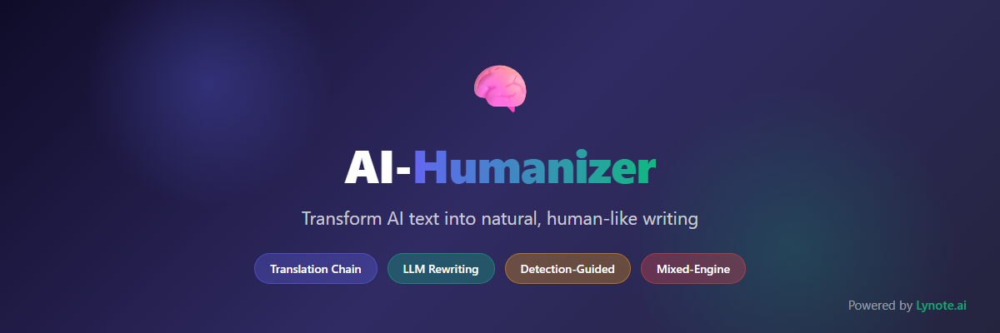

<div align="center">

# Lynote Humanize Text

**Open-source AI humanizer: rewrite AI-generated drafts into natural, human-sounding prose — and see every step it takes.**

<a href="https://trendshift.io/repositories/35405?utm_source=trendshift-badge&amp;utm_medium=badge&amp;utm_campaign=badge-trendshift-35405" target="_blank" rel="noopener noreferrer"></a>

[](https://github.com/lynote-ai/humanize-text/stargazers)
[](LICENSE)
[](https://www.python.org/)
[](https://github.com/lynote-ai/humanize-text/commits)

[Quick start](#-quick-start) · [Examples](#-showcase--5-real-examples) · [Try it online](https://lynote.ai/ai-humanizer?utm_source=github&utm_medium=readme&utm_campaign=humanize-text&utm_content=nav) · [Humanizer API](https://lynote.ai/ai-humanizer-api?utm_source=github&utm_medium=readme&utm_campaign=humanize-text&utm_content=nav) · [Discord](https://discord.gg/NzcH5DYzBj) · [中文](README-zh.md)

<p align="center">
  
</p>

</div>

---

## ✨ Before → After

<table>
<tr>
<th width="50%">AI draft (input)</th>
<th width="50%">After the pipeline (output)</th>
</tr>
<tr>
<td>

Quantum computing has been proposed as a paradigm shift for solving certain optimization and simulation tasks. Unlike classical bits, qubits can represent superpositions, enabling parallel computation in specific problem structures.

</td>
<td>

Quantum computing has attracted much attention as an innovative method for solving certain optimization and simulation problems. Unlike traditional bits, qubits can assume a superposition state, which enables parallel computing in certain problem structures.

</td>
</tr>
</table>

<sub>Excerpt from [Example 01](examples/showcase/example_01.md) — the full trace shows every intermediate step (Chinese → Japanese → Finnish → English).</sub>

---

## 🚀 Quick start

```bash
git clone https://github.com/lynote-ai/humanize-text.git
cd humanize-text
pip install -r requirements.txt
cp config/config.example.toml config/config.toml   # add your LLM + Niutrans keys

python -m src.standard.pipeline --input "Your AI-generated text here"
```

`--input` takes either a text string or a path to a `.txt` file. Add `--verbose` to watch each step, or `--json` to get the full step-by-step trace as JSON.

> Don't want to set up keys? Try the hosted version at **[lynote.ai](https://lynote.ai/ai-humanizer?utm_source=github&utm_medium=readme&utm_campaign=humanize-text&utm_content=quickstart)** — paste and go.

---

## Why this project

- **Open, not a black box.** Most humanizers hide what they do behind marketing claims. Here every step is readable code, and every run can be traced.
- **Runs end-to-end with your own keys.** DeepSeek (default), OpenRouter, Atlas Cloud, OrcaRouter, Runcrate, LiteLLM, or any OpenAI-compatible endpoint.
- **Three ways to run it.** Python CLI, a no-code [n8n workflow](n8n/humanize_standard.json), or Docker.
- **Research included.** We also open-source the [structure-first data pipeline](#-how-we-train-our-own-model-research) we use to train our own rewrite model.

---

## How it works

The open pipeline combines two LLM rewrites with two machine-translation hops across distant languages and different engines:

| Step | Engine | From → To | Purpose |
|------|--------|-----------|---------|
| 1 | LLM (temp 1.3) | Input → Chinese | Humanizing rewrite + language shift |
| 2 | LLM (temp 1.3) | Chinese → Japanese | Second rewrite, carries Step 1 as history |
| 3 | Google Translate | Japanese → Finnish | First hop — distant-language restructuring |
| 4 | Niutrans | Finnish → English | Second hop — cross-engine reconstruction |

**Why this chain works**

1. **Steps 1–2 (LLM rewrite):** A high-temperature rewrite while translating breaks the statistical patterns typical of AI text. Step 2 carries Step 1 as conversation history to keep the text coherent.
2. **Steps 3–4 (multi-engine translation):** Two different translation engines introduce compounding structural changes, so no single engine's fingerprint survives.
3. **Distant languages:** Chinese → Japanese → Finnish maximizes linguistic distance at each hop before reconstructing English.

### Tiers

| Tier | What it does | Best for |
|---|---|---|
| `standard` | 2 LLM rewrites + 2 MT hops | The default balance |
| `advanced` | + multi-round LLM rewriting | Deeper restructuring |
| `focus` | + detection-guided feedback loop | Maximum restructuring |

Technical details: [docs/pipeline.md](docs/pipeline.md) · [docs/techniques.md](docs/techniques.md)

---

## Ways to run it

| Method | Who it's for | How |
|--------|-------------|-----|
| **Python CLI** | Developers | See [Quick start](#-quick-start) |
| **n8n workflow** | No-code automation users | Import [`n8n/humanize_standard.json`](n8n/humanize_standard.json) |
| **Docker** | Self-hosting a REST endpoint | `docker compose up -d` — see [docs/installation.md](docs/installation.md) |
| **Hosted** | Anyone who wants zero setup | [lynote.ai](https://lynote.ai/ai-humanizer?utm_source=github&utm_medium=readme&utm_campaign=humanize-text&utm_content=ways-to-run) or the [Humanizer API](#hosted-version-lynoteai--api) |

<details>
<summary><b>Configuration examples (DeepSeek, OpenRouter, Atlas Cloud, OrcaRouter, Runcrate)</b></summary>

**DeepSeek (default):**

```toml
[api_keys]
deepseek_api_key = "sk-..."
niutrans_api_key = "your-key"

[llm]
provider = "deepseek"
```

**OpenRouter:**

```toml
[api_keys]
openrouter_api_key = "sk-or-..."
niutrans_api_key = "your-key"

[llm]
provider = "openrouter"
model = "deepseek/deepseek-chat"   # any OpenRouter model slug
```

**Atlas Cloud:**

```toml
[api_keys]
atlascloud_api_key = "ak-..."
niutrans_api_key = "your-key"

[llm]
provider = "atlascloud"
model = "qwen/qwen3.5-flash"
```

**OrcaRouter:**

```toml
[api_keys]
orcarouter_api_key = "sk-orca-..."
niutrans_api_key = "your-key"

[llm]
provider = "orcarouter"
model = "deepseek/deepseek-chat"   # any OrcaRouter model slug
```

**Runcrate:**

```toml
[api_keys]
runcrate_api_key = "rc-..."
niutrans_api_key = "your-key"

[llm]
provider = "runcrate"
model = "deepseek-ai/DeepSeek-V4.1-Flash"   # any Runcrate model id
```

Override the endpoint with `base_url` in `[llm]`, or via the `LLM_BASE_URL` / `LLM_API_KEY` environment variables. Full reference: [docs/configuration.md](docs/configuration.md).

</details>

<details>
<summary><b>n8n workflow setup</b></summary>

1. Import `n8n/humanize_standard.json` into your n8n instance.
2. Configure the LLM API key and URL in the HTTP Request nodes (defaults to DeepSeek; point at `https://openrouter.ai/api/v1/chat/completions` to use OpenRouter).
3. Run — input text goes in, rewritten text comes out.

More: [docs/n8n-guide.md](docs/n8n-guide.md)

</details>

---

## 📊 Showcase — 5 real examples

We ran the open pipeline end-to-end on 5 real texts and saved every intermediate step.

| # | Topic | Detector verdict on our test | Confidence |
|---|-------|-----------|------------|
| [01](examples/showcase/example_01.md) | Quantum Computing | `human` | 0.9997 |
| [02](examples/showcase/example_02.md) | Quantum Readiness Strategy | `human` | 0.9982 |
| [03](examples/showcase/example_03.md) | Sustainable Supply Chains | `human` | 0.7810 |
| [04](examples/showcase/example_04.md) | Financial Literacy | `human` | 0.9924 |
| [05](examples/showcase/example_05.md) | Peer Review in Science | `human` | 0.7218 |

Each example shows: original input → Step 1 → Step 2 → Step 3 → Step 4 (final). These are illustrative snapshots from one detector at one point in time, not a guarantee — see [Responsible use & limitations](#responsible-use--limitations).

### Quality metrics

Expert evaluation on 50 text pairs:

| Dimension | Score (out of 10) |
|-----------|-------------------|
| Information Completeness | 10.0 |
| Language Fluency | 9.0 |
| Style Adaptability | 8.8 |
| Readability | 9.2 |
| Creativity & Impact | 8.5 |
| **Overall** | **9.1** |

Key information retention: **100%** (50/50 pairs).

---

## 🔬 How we train our own model (research)

Style-only rewriting has a ceiling: recent research shows that what separates human from AI writing is largely discourse-level structure, not surface style (see our [research notes](docs/research-notes.md) on the StoryScope study, COLM 2026).

So for our own rewrite model we built a **structure-first data pipeline**, and we open-source it in [`training-data-pipeline/`](training-data-pipeline/):


- **SFT → KTO.** A supervised pass learns the rewrite task; a preference (KTO) pass teaches the model to prefer genuine structural rewrites over surface edits.
- **Structure-first negatives.** Rejected outputs are selected for under-editing, structural damage, semantic drift, over-rewriting, repetition, and refusal, in a fixed 60% / 20% / 20% mix.
- **Deterministic & auditable.** SHA-256 identity per pair, seeded splits, versioned YAML policies, two-layer validation, and a human review gate.
- **What's included:** code, policies, tests, and 50 demo records per stage. Model weights and full datasets are not included.

Docs: [DATA_CONSTRUCTION.md](training-data-pipeline/docs/DATA_CONSTRUCTION.md) · [ARCHITECTURE.md](training-data-pipeline/docs/ARCHITECTURE.md) · [PROMPTS.md](training-data-pipeline/docs/PROMPTS.md)

---

## Hosted version: Lynote.ai & API

If you'd rather not manage keys and infrastructure, [Lynote.ai](https://lynote.ai/ai-humanizer?utm_source=github&utm_medium=readme&utm_campaign=humanize-text&utm_content=hosted) runs our own model trained with the structure-first method above, and automatically picks the right approach for each passage.

| | This repo | Lynote.ai |
|---|---|---|
| Engine | Open translation-chain pipeline | Our own model trained with the structure-first method |
| Tier selection | Manual | Automatic, per passage |
| Languages | Configurable target language | 80+ languages |
| Setup | Python + API keys | None — paste and go |

**For developers — the [Lynote Humanizer API](https://lynote.ai/ai-humanizer-api?utm_source=github&utm_medium=readme&utm_campaign=humanize-text&utm_content=api-section):** one synchronous REST call, Markdown and line breaks preserved, per-request Purpose and Readability controls, 80+ languages. Billing: 1 credit per input word (Chinese counts 1 character as 1 word); output is free.

```bash
curl https://api.lynote.ai/v1/humanize \
  -H "Authorization: Bearer $LYNOTE_API_KEY" \
  -H "Content-Type: application/json" \
  -d '{"text": "Your AI-generated draft here", "readability": "University", "purpose": "Academic"}'
```

Plans, rate limits, and full docs: [lynote.ai/ai-humanizer-api](https://lynote.ai/ai-humanizer-api?utm_source=github&utm_medium=readme&utm_campaign=humanize-text&utm_content=api-docs)

---

## Responsible use & limitations

This toolkit is for improving the readability and natural cadence of AI-assisted drafts. If you are writing in an academic setting, follow your institution's policies on AI use and disclosure. Please don't use it to misrepresent authorship.

- **Detection is probabilistic.** No rewriting method makes text reliably undetectable. Detectors update faster than pipelines do, and results vary by input length, subject matter, and detector. This project guarantees no particular classification.
- **Translation costs precision.** Technical terms and citations can drift, and deeper tiers trade more of your original voice for more restructuring. Where exact wording matters, review the output carefully.

See also [SECURITY.md](SECURITY.md).

---

## Documentation

- [Installation](docs/installation.md) · [Configuration](docs/configuration.md) · [n8n guide](docs/n8n-guide.md) · [API reference](docs/api-reference.md)
- [Pipeline technical details](docs/pipeline.md) · [4 methodologies reference](docs/techniques.md)
- [Research notes](docs/research-notes.md) · [Training-data pipeline](training-data-pipeline/)
- [Open source vs Lynote.ai](docs/lynote-comparison.md) · [FAQ](docs/faq.md)

<details>
<summary><b>Repo structure</b></summary>

```
src/                         # the open humanizer pipeline (runnable)
├── standard/                # Standard pipeline — 4-step chain, CLI entry
│   ├── pipeline.py
│   ├── llm_client.py        # OpenAI-compatible client
│   ├── llm_rewriter.py
│   └── translators.py       # Google + Niutrans engines
└── methodologies/           # four methodology reference implementations + FastAPI app

training-data-pipeline/      # structure-first SFT + KTO data pipeline (research)
├── code/                    # ordered stages a–f, harness, tests
├── configs/  data/demos/    # versioned policies + 50 demo records per stage
└── docs/                    # ARCHITECTURE, DATA_CONSTRUCTION, PROMPTS

examples/
├── example_usage.py         # minimal entry
├── showcase/                # 5 real samples with every intermediate step
└── legacy/                  # earlier examples + method comparison outputs

n8n/                         # no-code workflow
docker/                      # Dockerfile for the REST endpoint
```

</details>

---

## Related projects

- [AI Text Detector](https://github.com/lynote-ai/ai-text-detector) — our open-source detector · [try it on Hugging Face](https://huggingface.co/spaces/Lynote/free-ai-detector)
- [Lynote AI Detector](https://lynote.ai/ai-detector?utm_source=github&utm_medium=readme&utm_campaign=humanize-text&utm_content=related) — sentence-level scoring, free

## Contributing

Issues and PRs are welcome — new LLM providers, translation engines, language pairs, and evaluation scripts are especially useful. See [CONTRIBUTING.md](CONTRIBUTING.md), or start a thread in [Discussions](https://github.com/lynote-ai/humanize-text/discussions).

## License

MIT — see [LICENSE](LICENSE).

---

<div align="center">

⭐ **If this project helps you, please give it a star** — it helps more people find it.

[Website](https://lynote.ai?utm_source=github&utm_medium=readme&utm_campaign=humanize-text&utm_content=footer) · [Discord](https://discord.gg/NzcH5DYzBj) · [X](https://x.com/lynote_ai) · [Product Hunt](https://www.producthunt.com/products/lynote-ai?launch=lynote-3)

</div>
